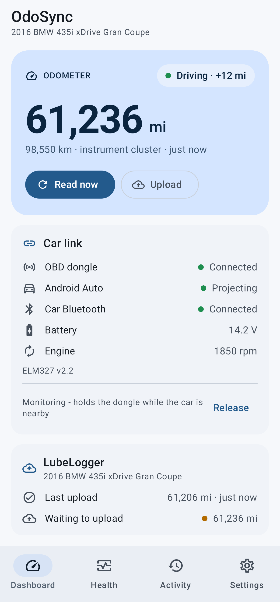
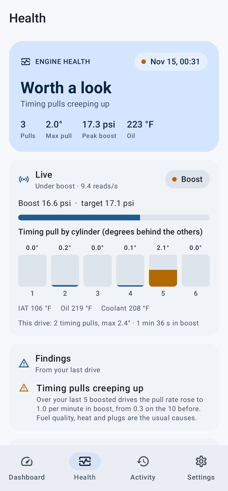
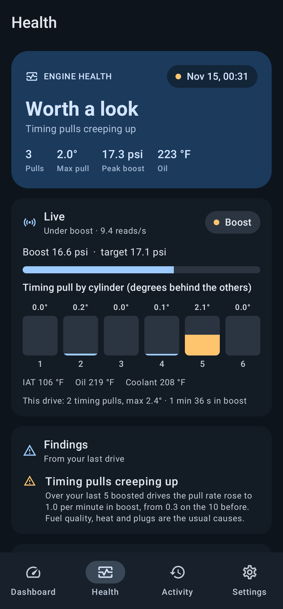
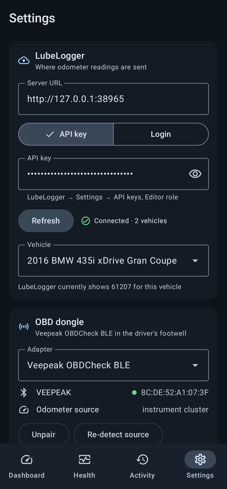

# OdoSync

Android app that reads the real odometer from a BMW F-series car (built for a 2016 F36 435i)
through a **Veepeak OBDCheck BLE** dongle. After every drive it posts the reading to
**LubeLogger**, so mileage-based reminders stay current without anyone typing a number in.

It also watches the **engine's health** on every drive (N55, read-only): per-cylinder timing
pulls, boost against target, intake air, oil and coolant temperature, fuel pressure and
misfires. Each drive's summary goes to **Glovebox/LubeLogger** as a note (with a CSV data log),
and to **Home Assistant**, which raises an alert when timing pulls start creeping up. See
[Engine health](#engine-health).

It's built to sit next to **wireless Android Auto** without getting in its way. Music, calls and maps behave
exactly as before (see [Android Auto coexistence](#android-auto-coexistence)).

<p align="center">
  
  
  
  
  
</p>

```
 Veepeak (OBD port) ──BLE──▶ OdoSync (phone) ──HTTPS, after the trip──▶ LubeLogger / Glovebox
        │                         ▲            └─────────────────────▶ Home Assistant
   KOMBI 22 D1 0D           car Bluetooth / Android Auto / voltage = "trip" signals
   DME   22 4Axx/42xx/58xx  (engine health)
```

## How a drive works

1. **Wake-up.** OdoSync starts when one of these happens:
   - your phone connects to the car's Bluetooth (the wireless AA adapter or head unit)
   - the paired dongle starts advertising nearby (companion-device presence)
   - you open the app
2. **Idle link.** OdoSync opens a low-duty BLE link and reads only the adapter's own voltage
   (`ATRV`). That command never touches the car's CAN bus, so a parked car is never woken or
   kept awake.
3. **Trip start.** Android Auto is projecting, the car's Bluetooth is linked, or the voltage
   jumps above ~13.1 V (alternator charging). OdoSync then asks the instrument cluster for the
   odometer. If the cluster answers, the trip is on.
4. **During the trip.** One odometer read a minute: a 5-byte request and a 2-frame reply. With
   engine health on, the time in between goes to reading the engine computer (DME): gently
   while cruising, quickly under boost (see [Engine health](#engine-health)).
5. **Trip end.** Android Auto or car Bluetooth drops and the engine is off. Without AA, it's
   the engine staying off longer than an auto start/stop pause (2.5 min), or the car going
   silent. The last reading goes into the upload queue.
6. **Upload.** WorkManager posts it to LubeLogger once a network is available, retrying with
   backoff. Before posting, OdoSync checks LubeLogger's latest odometer and never writes a
   lower number. Readings are saved to disk the moment they're taken, so an app kill
   mid-drive loses nothing. The drive's engine-health summary is saved on the phone, judged
   against earlier drives, and queued for Glovebox and Home Assistant.

## Where the odometer comes from

All reads are UDS *ReadDataByIdentifier* in the default session. They're read-only, need no
security access, and write nothing to the car.

| Source | ECU | Request (tester 6F1, ext. addressing) | Reply |
|---|---|---|---|
| **KOMBI** (dash odometer, tried first) | 0x60 → replies on 0x660 | `60 03 22 D1 0D` | 2 × uint32 km |
| DME (fallback) | 0x12 → 0x612 | `12 03 22 55 8E` | uint32 km |
| OBD-II PID A6 (fallback, newer DME software only) | 7E0 → 7E8 | `01 A6` | uint32 × 0.1 km |

The DIDs and reply layouts come from real F32/F36 captures in the
[OBDb BMW 4 Series](https://github.com/OBDb/BMW-4-Series) signal set. The unit tests replay
those captures. Example capture: `660 F1 10 0B 62 D1 0D 00 01` / `660 F1 21 52 94 00 01 52 94`
→ 0x00015294 = 86,676 km.

ELM327 setup for BMW mode: `ATSH6F1 · ATCRA660 · ATCEA60 · ATFCSH6F1 · ATFCSD60300000 · ATFCSM1`.
Flow control is required because every odometer reply is multi-frame. On the very first
read, if the cluster stays silent while the engine ECU answers plain OBD, OdoSync switches
from padded ISO 15765-4 frames (`ATSP6`) to variable-length frames (`ATPB C101 / ATSP B`). It
remembers whichever works.

The car counts whole kilometres. Miles are `round(km × 0.621371)` plus an optional offset, so
the number can differ from the dash by about ±1 mi.

## Engine health

Every drive, OdoSync reads the engine computer (DME 0x12, MEVD17.2) and keeps what matters for
a tuned N55: is any cylinder pulling timing, is boost making target, how hot do the intake air
and oil get, is the fuel supply keeping up. Like the odometer, it's all UDS
*ReadDataByIdentifier* in the default session: read-only, no security access, nothing written.
`Elm327` refuses to send anything but `22` and OBD mode `01` requests, whatever asks.

### What it reads

| Value | DID | Scaling | Notes |
|---|---|---|---|
| Ignition timing, cyl 1-4 | `4A49` `4A4A` `4A4C` `4A4D` | int16 / 10 ° | OBDb captures |
| Ignition timing, cyl 5-6 | `4A4E` `4A4F` | int16 / 10 ° | inferred, verified per car (below) |
| Boost pressure / target | `4205` / `4AB0` | uint16 / 128, / 256 kPa abs | |
| Barometric pressure | `4201` | uint16 / 256 kPa | |
| Intake air temperature | `580F` (`4015`) | × 0.75 − 48 °C | |
| Oil temperature | `4408` (`57C3`, `4402`) | °C × 10 or K × 10 or K × 100 | encoding told apart by range |
| Coolant temperature | `5805` (`4300`) | as oil | |
| Fuel rail / low-side pressure | `56D7` / `58F3` | / 50 bar, / 1000 bar | |
| Lambda, vehicle speed | `5889`, `4AB1` | × 16 / 65535, / 100 km/h | |
| Misfire counters 1-6 | `4B23` `4B24` `4B25` `4B30` `4B31` `4B32` | uint16 | per-drive difference |

The DIDs and scalings come from real F-series captures in the [OBDb](https://github.com/OBDb)
BMW signal sets, and `DmeSignalsTest` replays them. On the first drive OdoSync asks the DME for
each value once (about 25 requests, a few seconds), keeps the first candidate that answers
sensibly, and checks whether one request can carry two DIDs. The result is cached for 30 days;
*Settings → Engine health → Re-learn DME signals* forces a fresh look.

### Timing pulls

The DME doesn't expose the knock-control correction itself, but it does expose each
cylinder's final ignition angle. Under boost all six run the same base timing, so a cylinder
knock control has retarded sits below the others. OdoSync compares each read against the median
of all six and counts a **pull** when a cylinder is 1.5° or more behind; the pull ends once it's
back within half that. Pulls on several cylinders at the same moment are one event.

Reads are sequential, so when timing swings for every cylinder at once (tip-in, or the
torque cut the 8HP asks for on an upshift) the cylinders read a few hundred ms earlier can
look ahead of the one read now. A pull therefore only counts straight away when the cylinder
also sits below the partner read in the *same* reply (cylinders 1/2, 3/4 and 5/6 arrive
together); otherwise it has to show up on two reads in a row. `TripAnalyzerTest` covers both
cases, including a shift caught mid-round.

**Cylinders 5 and 6.** OBDb's timing captures come from four-cylinder cars. `4A4E`/`4A4F`
are the next two IDs in the same block and answer on six-cylinder DMEs, so OdoSync reads them
but doesn't trust them until a drive shows them tracking cylinders 1-4 (within 3° in nine
reads out of ten while timing moves around). Until then they're logged and left out of pull
detection; if they don't behave like timing they're dropped for good, and the Activity log
says so.

This is a health monitor, not a tuning logger: under boost a Veepeak manages a couple of
complete six-cylinder rounds a second, which catches the pulls that persist and the trend
across drives. For dialing a tune in, log with the tuner's own app.

### Sampling and the Bluetooth link

- **Cruising:** boost and target every second, all six cylinders every 5 s, temperatures and
  the rest every 5-15 s. Under two requests a second at the low-power BLE interval.
- **Under boost** (from about 2 psi, held 4 s afterwards): cylinders and boost back to back as
  fast as the dongle answers, with intake air, fuel pressure and lambda slotted in. For the
  duration the BLE link asks for Android's *balanced* connection interval, then drops back.
  The odometer read waits (up to 3 minutes) while this is going on.
- Two DIDs per request when the DME allows it. That's the most a plain ELM327 fits in one CAN
  frame with BMW extended addressing.

### After each drive

- **Findings.** The drive is judged on its own and against your history:
  - a single pull of 3° or more (alert);
  - *more timing pulls than usual*: pulls per minute in boost at least double your median over
    the last 10 boosted drives;
  - *timing pulls creeping up*: the median of the last 5 boosted drives 50% or more above the
    10 before them;
  - the same cylinder leading the pulls on 3 boosted drives in a row;
  - boost 2.2 psi or more under target for over a second (a boost leak or lazy wastegate),
    overshooting target, or drifting further from target than usual;
  - oil at 130 °C or more, intake air at 65 °C or more under boost, 10+ misfires on a counter,
    and low-side fuel pressure under 3 bar in boost.

  Only drives with 20 s or more in boost count toward trends. The thresholds are under
  *Settings → Engine health → Alert thresholds*.
- **Health tab.** Status, a live view while driving, the last drive, the pull-rate trend,
  pulls by cylinder over 30 days and recent drives. Each drive's CSV data log can be shared
  from there (it opens in a spreadsheet or on datazap.me).
- **Notification.** If a drive raised a finding, a notification once it has ended, never
  mid-drive.
- **Glovebox / LubeLogger notes.** Through the same connection as the odometer:
  - a **drive log** note per day (or one per drive), each drive as a section with its findings
    and readings, and its CSV log attached (Glovebox opens it in its attachment viewer);
  - a pinned **Engine health** note, rewritten after every drive: status, the last drive's
    findings, a table of recent boosted drives and pulls by cylinder for the last 30 days.

  Uses `/api/vehicle/notes/add`, `/api/vehicle/notes/update` and `/api/documents/upload`; an
  *Editor* API key is enough.
- **Home Assistant.** With a URL and a long-lived access token (your HA profile → Security),
  each drive updates these sensors through the REST API (prefix configurable, default
  `odosync`):

  | Entity | State |
  |---|---|
  | `sensor.odosync_engine_health` | `ok` / `watch` / `alert`, findings in the attributes |
  | `sensor.odosync_timing_pull_max` | biggest pull (°), cylinder and per-cylinder counts |
  | `sensor.odosync_timing_pull_rate` | pulls per minute in boost |
  | `sensor.odosync_boost_peak`, `_boost_vs_target` | psi or bar |
  | `sensor.odosync_iat_peak`, `_oil_temp_peak`, `_coolant_temp_peak` | °F or °C |
  | `sensor.odosync_misfires` | misfires counted on the drive |

  and fires `odosync_drive_summary` after every drive and `odosync_engine_alert` when it raised
  a finding. Turn the alert into a push with an automation:

  ```yaml
  alias: 435i engine alert
  triggers:
    - trigger: event
      event_type: odosync_engine_alert
  actions:
    - action: notify.mobile_app_your_phone
      data:
        title: "{{ trigger.event.data.title }}"
        message: "{{ trigger.event.data.message }}"
  ```

  Sensors created through the REST API live until Home Assistant restarts and come back on the
  next drive; history and long-term statistics keep their values.

Uploads respect *Upload on Wi-Fi only* and retry with backoff. Drives that pile up offline go
out in order, and each one remembers what has already gone where.

## Adapters

*Settings → OBD dongle → Adapter*:

- **Veepeak OBDCheck BLE** (default, what the car has).
- **WiCAN Pro (Bluetooth LE)**: groundwork, untested on the car. OdoSync recognises the
  WiCAN's BLE service (`FEE0`/`FEE1`). Turn BLE on in the WiCAN web UI; its characteristic needs
  an encrypted link, so Android asks once for the BLE passkey set there (default `123456`).
  Pairing goes through the same *Pair dongle* sheet (the name filter matches "wican").
- **WiCAN Pro (Wi-Fi)**: groundwork, untested on the car. ELM327 over TCP on port 35000, at
  `192.168.0.10` on the WiCAN's own access point or the address your router gives it. Set the
  WiCAN's protocol to *ELM327*. Wireless Android Auto keeps the phone's Wi-Fi on the car, so
  this only reaches the WiCAN while the phone shares its network (parked at home, or without
  wireless AA); for driving with wireless AA, use the BLE option.

All three go through the same `ObdLink` interface (`ble/BleSerial`, `link/TcpLink`, and an
in-memory fake for the tests), so the ELM327, odometer and engine-health code doesn't care
which one it's talking to.

## Android Auto coexistence

Wireless AA projects over **Wi-Fi** and uses **classic Bluetooth** for calls (HFP) and setup.
OdoSync stays off both:

- **BLE only, no bonding.** The dongle is never paired in Android's Bluetooth settings, never
  becomes an audio or hands-free device, and never competes with the car for HFP. (The
  Veepeak is dual-mode. Don't pair its classic side.)
- **Low-duty radio use.** The link runs at `CONNECTION_PRIORITY_LOW_POWER` (~100 ms
  interval). OdoSync never scans on its own: the system's companion-device service handles
  presence, and reconnects use `autoConnect` (controller-managed, low duty). The odometer alone
  is about 60 bytes a minute. Engine health adds a couple of small requests a second while
  cruising and, only under boost, the *balanced* interval with a few kB/s. Switch *Monitor the
  engine* off to go back to odometer-only.
- **No Wi-Fi use.** The dongle is BLE. Uploads are network-constrained WorkManager jobs that
  run at trip end. While AA's Wi-Fi link (which has no internet) is up, Android routes them
  over cellular. Turn on *Upload only on Wi-Fi* to wait until you're home.
- **Silent.** No audio focus, sounds or vibration while driving. The foreground notification
  is `IMPORTANCE_MIN`. OdoSync isn't an Android Auto app and never appears on the car screen.
  Engine-health findings are posted after the drive has ended.
- **Single-client dongle.** While OdoSync holds the dongle, apps like BimmerLink or Car
  Scanner can't use it. Tap *Release dongle* first.

## Setup

1. Install the APK, open OdoSync, and grant **Nearby devices** (plus notifications).
2. **LubeLogger.** Enter your server URL. Then either:
   - create an API key with the *Editor* role (LubeLogger → Settings → API keys), or
   - use your username and password.

   Tap **Test & load vehicles** and pick the 435i.
3. **Dongle.** Plug in the Veepeak, switch the ignition on, tap **Pair dongle** and choose
   "VEEPEAK" in the system sheet. This is a *companion-device* association, not Bluetooth
   pairing.
4. **Trip detection.** Tick the car's Bluetooth device, i.e. the one your phone connects to
   for wireless AA. This is the most reliable trigger.
5. **First drive.** Check the Status tab: the odometer card shows `xxx mi` with the raw km
   underneath. If the miles differ from the dash, set **Offset**.
6. **Engine health** (optional). It's on by default and needs nothing else for the Health
   tab. Pick US or metric units under *Settings → Engine health*; *Drive notes* uses the
   LubeLogger connection; *Home Assistant* needs its URL and a long-lived access token (tap
   **Test**). The first drive spends a few seconds learning the DME.

## Troubleshooting

The Activity log, which you can share from the Status tab, records every connect, ELM reply,
trip start/end and upload.

- **"adapter may not support BMW extended addressing"**: the dongle rejected `ATCEA`.
  Genuine Veepeak OBDCheck BLE units support it (BimmerCode lists them for F-series coding).
- **Odometer read failed: KOMBI: unparsed reply …**: share the log. The raw reply is in it.
- **Upload failed: HTTP 401**: wrong key or credentials, or the key isn't *Editor*. An HTML
  reply means LubeLogger redirected to its login page.
- **Nothing happens when you get in the car**: make sure step 4 is done, and that *Battery
  optimisation* shows *Unrestricted* on the Setup tab (pairing usually takes care of it).
- **Health tab says the engine computer isn't answering**: the DME didn't reply to the
  discovery requests. It retries on the next drive; share the log if it keeps happening.
- **"Cylinder 5/6 timing … doesn't behave like ignition timing"**: that DID isn't timing on
  this DME. Pulls are still tracked on the other cylinders.

## Build & releases

```bash
./gradlew :app:testDebugUnitTest :app:assembleRelease
```

The unit tests include `ScreensTest`, which renders every screen on the JVM (Robolectric) as a
crash check. Add `-PrecordScreenshots` to refresh the PNGs in `docs/screenshots/`. The
engine-health tests replay OBDb captures (`DmeSignalsTest`), run discovery and sampling
through the real `Elm327`/`CarReader` stack against an in-memory ELM327 + six-cylinder DME
(`FakeElm`, `FakeN55`), and drive the analyzer through boost, pulls, shifts and underboost.

CI (`.github/workflows/ci.yml`) runs the unit tests and Android lint on every push and pull
request, then builds a release APK and uploads it as a workflow artifact. To publish a GitHub
release (APK + SHA-256), bump `odosync.version` in `gradle.properties`, commit, and then either:

- **Actions → CI → Run workflow**, entering the version (e.g. `0.1.1`) — CI tests, builds,
  creates the `v0.1.1` tag on that commit and publishes the release; or
- push a tag: `git tag v0.1.1 && git push origin v0.1.1`.

`versionName` comes from the tag (`v0.1.0` → `0.1.0`; untagged builds are `0.1.0-dev.<run>`),
and `versionCode` is the workflow run number, so every CI build installs over the last one.

Release signing reads `ODOSYNC_KEYSTORE`, `ODOSYNC_KEYSTORE_PASSWORD` and `ODOSYNC_KEY_ALIAS`
from the environment and falls back to the debug key without them. In CI they come from the
repository secrets `ODOSYNC_KEYSTORE_BASE64` (`base64 -w0 odosync-release.jks`),
`ODOSYNC_KEYSTORE_PASSWORD` and `ODOSYNC_KEY_ALIAS` (`odosync`). Release builds refuse to publish
without the release key, because a debug-signed APK can't be updated by later releases. Never
commit the keystore (`*.jks` is git-ignored).

Requirements: Android 12+ (companion-device presence) and a phone with Bluetooth LE.
