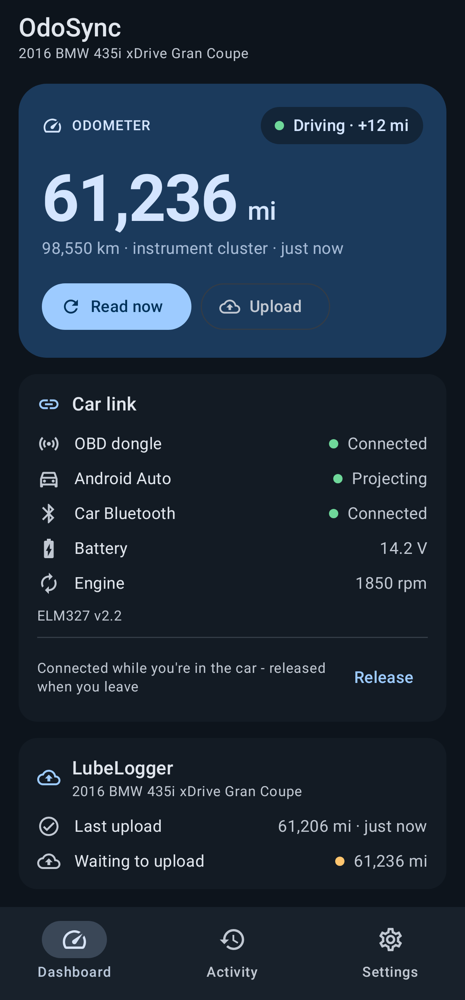
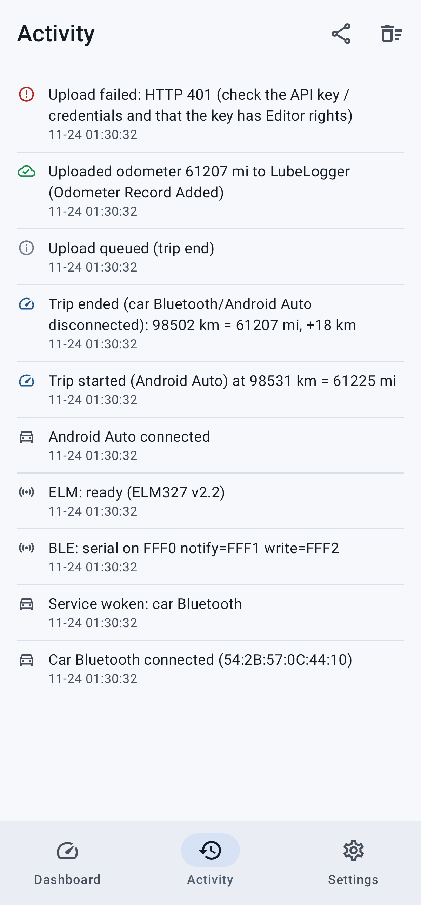

# OdoSync

Android app that reads the real odometer from a BMW F-series car (built for a 2016 F36 435i)
through a **Veepeak OBDCheck BLE** dongle. After every drive it posts the reading to
**LubeLogger**, so mileage-based reminders stay current without anyone typing a number in.

It's built to sit next to **wireless Android Auto** without getting in its way. Music, calls and maps behave
exactly as before (see [Android Auto coexistence](#android-auto-coexistence)).

<p align="center">
  
  
  
  
</p>

```
 Veepeak (OBD port) ──BLE──▶ OdoSync (phone) ──HTTPS, after the trip──▶ LubeLogger
        │                         ▲
   KOMBI 22 D1 0D           car Bluetooth / Android Auto / voltage = "trip" signals
```

## How a drive works

1. **Get in the car.** Your phone joins the car's Bluetooth (the wireless AA adapter or head
   unit). That's the only thing that starts OdoSync in the background. At home it doesn't run,
   scan or hold the dongle, and opening the app doesn't connect either. If no car device is
   picked in Settings, any device that reports itself as car audio counts.
2. **Connect.** OdoSync opens a low-duty BLE link to the dongle. While waiting for the engine it
   reads only the adapter's own voltage (`ATRV`), which never touches the car's CAN bus.
3. **Trip start.** Once Android Auto or the car's Bluetooth is up and the instrument cluster
   answers, the trip is on. An ongoing notification shows distance, time and the odometer.
4. **During the trip.** One odometer read a minute: a 5-byte request and a 2-frame reply.
5. **Trip end.** Android Auto or car Bluetooth drops and the engine is off. (Without AA, it's
   the engine staying off longer than an auto start/stop pause, or the car going silent.) The
   ongoing notification goes away and a dismissable **Trip complete** notification shows the
   distance, duration, average speed and odometer.
6. **Upload.** WorkManager posts the reading to LubeLogger once a network is available, retrying
   with backoff, and the trip notification updates with the result (uploaded, or why not).
   OdoSync never writes a number lower than LubeLogger already has. Readings are saved the
   moment they're taken, so an app kill mid-drive loses nothing.
7. **Release.** About 90 seconds after the car's Bluetooth disconnects, OdoSync drops the dongle
   and stops.

## Where the odometer comes from

All reads are UDS *ReadDataByIdentifier* in the default session. They're read-only, need no
security access, and write nothing to the car.

| Source | ECU | Request (tester 6F1, ext. addressing) | Reply |
|---|---|---|---|
| **KOMBI** (dash odometer, tried first) | 0x60 → replies on 0x660 | `60 03 22 D1 0D` | 2 × uint32 km |
| DME (fallback) | 0x12 → 0x612 | `12 03 22 55 8E` | uint32 km |
| OBD-II PID A6 (fallback, newer DME software only) | 7E0 → 7E8 | `01 A6` | uint32 × 0.1 km |

The DIDs and reply layouts come from real F32/F36 captures in the
[OBDb BMW 4 Series](https://github.com/OBDb/BMW-4-Series) signal set. The unit tests replay
those captures. Example capture: `660 F1 10 0B 62 D1 0D 00 01` / `660 F1 21 52 94 00 01 52 94`
→ 0x00015294 = 86,676 km.

ELM327 setup for BMW mode: `ATSH6F1 · ATCRA660 · ATCEA60 · ATFCSH6F1 · ATFCSD60300000 · ATFCSM1`.
Flow control is required because every odometer reply is multi-frame. On the very first
read, if the cluster stays silent while the engine ECU answers plain OBD, OdoSync switches
from padded ISO 15765-4 frames (`ATSP6`) to variable-length frames (`ATPB C101 / ATSP B`). It
remembers whichever works.

The car counts whole kilometres. Miles are `round(km × 0.621371)` plus an optional offset, so
the number can differ from the dash by about ±1 mi.

## Android Auto coexistence

Wireless AA projects over **Wi-Fi** and uses **classic Bluetooth** for calls (HFP) and setup.
OdoSync stays off both:

- **BLE only, no bonding.** The dongle is never paired in Android's Bluetooth settings, never
  becomes an audio or hands-free device, and never competes with the car for HFP. (The
  Veepeak is dual-mode. Don't pair its classic side.)
- **Lowest-duty radio use.** The link exists only while you're in the car and runs at
  `CONNECTION_PRIORITY_LOW_POWER` (~100 ms interval). OdoSync never scans; reconnects use
  `autoConnect` (controller-managed, low duty). During an AA drive the traffic is about 60 bytes
  a minute.
- **No Wi-Fi use.** The dongle is BLE. Uploads are network-constrained WorkManager jobs that
  run at trip end. While AA's Wi-Fi link (which has no internet) is up, Android routes them
  over cellular. Turn on *Upload only on Wi-Fi* to wait until you're home.
- **Silent.** No audio focus, sounds or vibration. The in-car notification is
  `IMPORTANCE_MIN` and the trip summary is silent. OdoSync isn't an Android Auto app and never appears on the car screen.
- **Single-client dongle.** While OdoSync holds the dongle, apps like BimmerLink or Car
  Scanner can't use it. Tap *Release dongle* first.

## Setup

1. Install the APK, open OdoSync, and grant **Nearby devices** (plus notifications).
2. **LubeLogger.** Enter your server URL. Then either:
   - create an API key with the *Editor* role (LubeLogger → Settings → API keys), or
   - use your username and password.

   Tap **Test & load vehicles** and pick the 435i.
3. **Dongle.** Plug in the Veepeak, switch the ignition on, tap **Pair dongle** and choose
   "VEEPEAK" in the system sheet. This is a *companion-device* association, not Bluetooth
   pairing.
4. **Trip detection.** Tick the car's Bluetooth device, i.e. the one your phone connects to
   for wireless AA. OdoSync connects to the dongle only after your phone joins it.
5. **First drive.** Check the Status tab: the odometer card shows `xxx mi` with the raw km
   underneath. If the miles differ from the dash, set **Offset**.

## Troubleshooting

The Activity log, which you can share from the Status tab, records every connect, ELM reply,
trip start/end and upload.

- **"adapter may not support BMW extended addressing"**: the dongle rejected `ATCEA`.
  Genuine Veepeak OBDCheck BLE units support it (BimmerCode lists them for F-series coding).
- **Odometer read failed: KOMBI: unparsed reply …**: share the log. The raw reply is in it.
- **Upload failed: HTTP 401**: wrong key or credentials, or the key isn't *Editor*. An HTML
  reply means LubeLogger redirected to its login page.
- **Nothing happens when you get in the car**: make sure step 4 is done (the Activity tab should
  log "Car Bluetooth connected"), and that *Background use* under Settings → Advanced shows
  *Unrestricted* (pairing usually takes care of it).

## Build & releases

```bash
./gradlew :app:testDebugUnitTest :app:assembleRelease
```

The unit tests include `ScreensTest`, which renders every screen on the JVM (Robolectric) as a
crash check. Add `-PrecordScreenshots` to refresh the PNGs in `docs/screenshots/`.

CI (`.github/workflows/ci.yml`) runs the unit tests and Android lint on every push and pull
request, then builds a release APK and uploads it as a workflow artifact. To publish a GitHub
release (APK + SHA-256), bump `odosync.version` in `gradle.properties`, commit, and then either:

- **Actions → CI → Run workflow**, entering the version (e.g. `0.1.1`) — CI tests, builds,
  creates the `v0.1.1` tag on that commit and publishes the release; or
- push a tag: `git tag v0.1.1 && git push origin v0.1.1`.

`versionName` comes from the tag (`v0.1.0` → `0.1.0`; untagged builds are `0.1.0-dev.<run>`),
and `versionCode` is the workflow run number, so every CI build installs over the last one.

Release signing reads `ODOSYNC_KEYSTORE`, `ODOSYNC_KEYSTORE_PASSWORD` and `ODOSYNC_KEY_ALIAS`
from the environment and falls back to the debug key without them. In CI they come from the
repository secrets `ODOSYNC_KEYSTORE_BASE64` (`base64 -w0 odosync-release.jks`),
`ODOSYNC_KEYSTORE_PASSWORD` and `ODOSYNC_KEY_ALIAS` (`odosync`). Release builds refuse to publish
without the release key, because a debug-signed APK can't be updated by later releases. Never
commit the keystore (`*.jks` is git-ignored).

Requirements: Android 12+ (companion device pairing) and a phone with Bluetooth LE.
